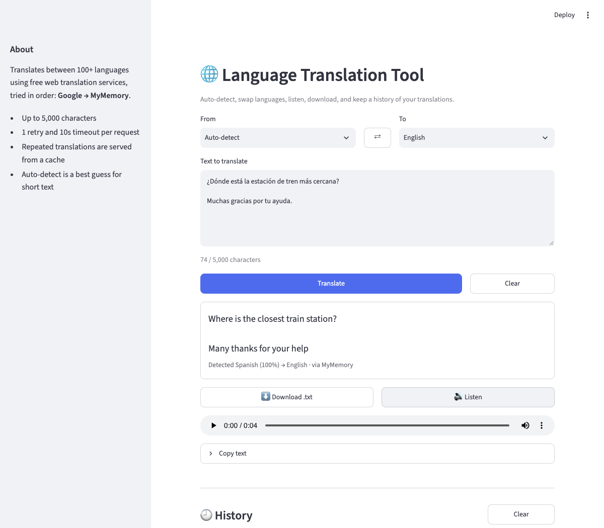

# 🌐 Language Translation Tool

[](https://github.com/Shivani-Radhakrishnan/CodeAlpha_LanguageTranslationTool/actions/workflows/tests.yml)

A Streamlit app that translates text between 100+ languages. It can detect the source language, read the translation aloud in the browser, and save it as a file. Behind the UI is a small, typed service layer. It tries each translation service in turn, retries failed requests, puts a time limit on each one, caches results, and shows a clear message when the network is down. A pytest suite covers it with all network calls mocked. Built for the CodeAlpha internship.



*Screenshot of the app running locally with `streamlit run app.py`. The result shows "via MyMemory" because Google rate-limited that machine, so the app fell back to the second service on its own.*

## Features

- **Auto-detect** the source language, shown with a confidence score ("Detected Spanish (100%)").
- **Swap languages (⇄)**: the translation moves into the input box. This also works after auto-detect, using the detected language.
- **Character counter** with a 5,000-character limit and input validation.
- **Listen 🔊**: [gTTS](https://pypi.org/project/gTTS/) creates an MP3 that plays in the browser.
- **Download .txt** and **Copy text** for the translation.
- **History** of the last 10 translations in the session, with *Use again* and *Clear*.
- **Line breaks kept**, so paragraphs stay paragraphs.
- **Fallback between services**: if Google Translate fails or rate-limits, the app tries MyMemory automatically.
- **Clear error states**: a network outage shows *"Couldn't reach the translation service… check your internet connection"*, not a stack trace.

## How it works

```
app.py (Streamlit UI, session state only)
   │
   ▼
TranslationService.translate(text, source, target)
   ├─ validate: non-empty, ≤ 5,000 chars, known language codes
   ├─ LRU cache (256 entries) → repeated requests make no network call
   ├─ detect source offline with langdetect (when "Auto-detect")
   └─ for each provider (Google → MyMemory):
         split into lines, then into chunks no longer than the provider's limit
         each request: 10 s timeout, 1 retry with backoff for errors that may clear up (rate limit, network, timeout)
         unsupported language pair → skip to the next provider
```

| Module | Responsibility |
|---|---|
| `translation_tool/providers.py` | `TranslationProvider` interface. `GoogleProvider` and `MyMemoryProvider` (both via [deep-translator](https://pypi.org/project/deep-translator/)) turn library and HTTP errors into `ProviderError(transient=…)`. |
| `translation_tool/service.py` | Validation, retries, timeouts, choosing the next service, chunking, caching. Raises `InputError` or `TranslationError` with messages that are safe to show users. |
| `translation_tool/languages.py` | Language table (offline) and deterministic `langdetect` detection, with its codes mapped to Google's (`he` → `iw`, `zh-cn` → `zh-CN`). |
| `translation_tool/speech.py` | gTTS text-to-speech as MP3 bytes, with timeout and error handling. |
| `translation_tool/config.py` | All limits, timeouts and defaults in one place. |

**Libraries used.** The original version used `googletrans==4.0.0-rc1`, an unmaintained release candidate that breaks whenever Google changes its web page. `deep-translator` is maintained, and it sits behind the provider interface, so it can be swapped out without touching the UI. deep-translator has no request timeout of its own, so the service runs each call in a worker thread with a deadline.

**Why gTTS, not pyttsx3.** pyttsx3 speaks through the *server's* speakers. A user on a deployed app hears nothing, and on headless Linux (CI, Streamlit Cloud, Docker) it fails because there is no audio device. gTTS returns an MP3, and `st.audio` plays it in the user's browser.

## Quick start

```bash
git clone https://github.com/Shivani-Radhakrishnan/CodeAlpha_LanguageTranslationTool.git
cd CodeAlpha_LanguageTranslationTool
python -m venv .venv && source .venv/bin/activate
pip install -r requirements.txt
streamlit run app.py
```

Use the service from Python:

```python
from translation_tool.service import TranslationService

result = TranslationService().translate("¿Dónde está la biblioteca?", "auto", "en")
print(result.text, result.detected_source, result.provider)
```

## Tests

```bash
pip install -r requirements-dev.txt
pytest
```

The suite makes **no real API calls**: `tests/conftest.py` blocks socket connections for every test. It covers:

- input validation and the character limit
- retries with backoff, timeouts, and falling back to the next service
- the friendly offline message
- caching (hits, separate entries per language pair, LRU eviction, failures not cached)
- keeping line breaks, and chunking long text
- provider error handling, including the real deep-translator parser fed a mocked HTTP response
- MyMemory language-code mapping and its error-as-text responses
- language detection
- text-to-speech
- UI tests with `streamlit.testing.AppTest`: translate, swap, listen, history, HTML escaping, error banners

CI runs the suite on Python 3.10 and 3.12.

## Limitations

- **Depends on free web services.** Google Translate's free web endpoint and MyMemory are unofficial or free tiers without an SLA. They can rate-limit (Google answers HTTP 429 to heavy or shared IPs) or change without notice. For production use, add a provider for a paid API (Google Cloud Translation, DeepL) by implementing `TranslationProvider`.
- MyMemory accepts at most 500 characters per request (the app splits text into chunks) and has a daily free quota.
- Auto-detect is statistical. Very short text (one or two words) may be detected wrongly or not at all; in that case the app leaves detection to Google, and MyMemory is skipped.
- Text-to-speech covers 65 of the 133 languages and reads at most the first 1,000 characters.
- History lives in the browser session and is lost on refresh.

## License

[MIT](LICENSE)
